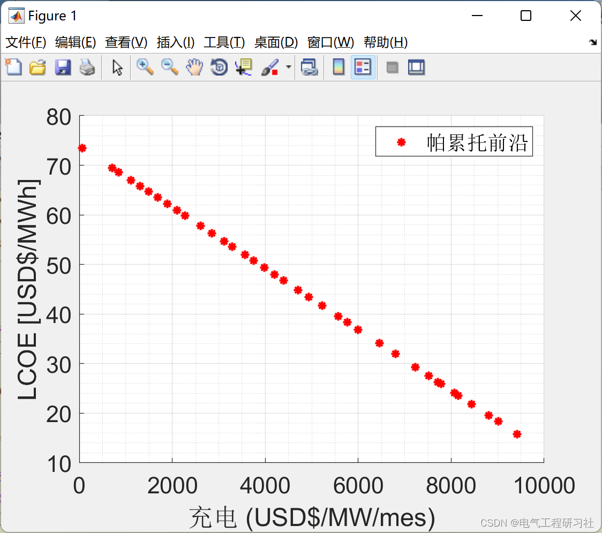
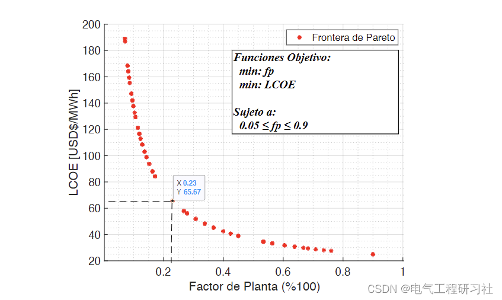
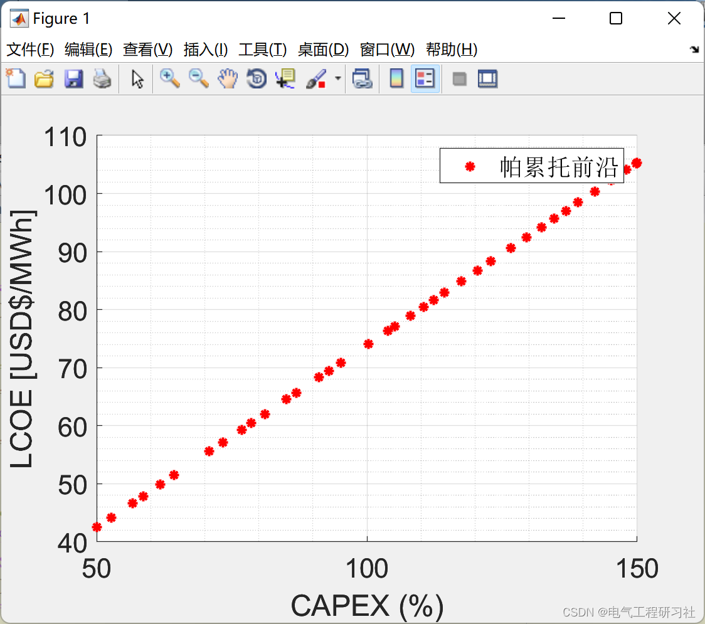
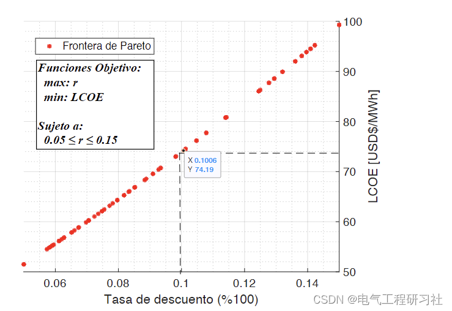
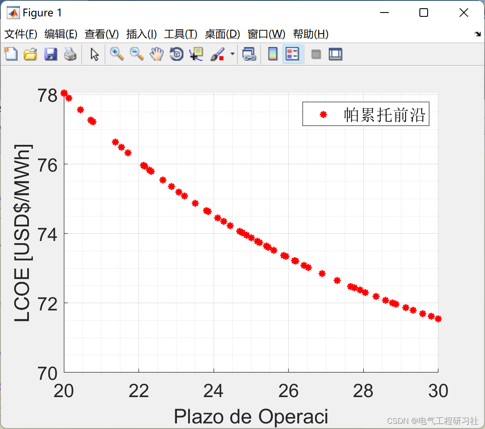
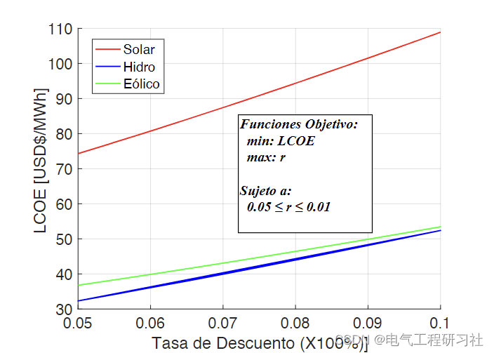

# Sensitivity Analysis of LCOE Power Cost Based on Multi-Objective Optimization Algorithm (Matlab Code Implementation)

In the context of power generation project financial assessments, the Levelized Cost of Electricity (LCOE) is used as a tool for comparing power generation technologies; however, one weakness of LCOE is its sensitivity to the input energy variables. In this sense, each author uses different criteria and methods for sensitivity analysis, including Monte Carlo method, Markov Chain, CVaR, Extended Lévy Model, etc. In this paper, based on the calculation of LCOE, a sensitivity analysis using multi-objective optimization techniques is proposed. For each variable defined as sensitive to sensitivity, a Pareto frontier is obtained. The optimization problem model is applied to the proposed research case to validate and analyze the results. The results indicate that the Pareto frontier method is very useful for the sensitivity analysis of LCOE, providing a great tool. Section 2: Mathematical Model
See section 4 for detailed mathematical models and explanations.
Section 3: Examples and Running Results
Edited
Edited
Edited
Edited
4 Matlab Code and Article Explanation
4.1 Download Link: Sensitivity Analysis for Levelized Cost of Electricity - LCOE with Multi-objective Optimization | IEEE Journals & Magazine | IEEE Xplore
4.2 Matlab Code Needed: Based on Multi-objective Optimization Algorithms for LCOE Power Cost Sensitivity Analysis (Matlab Code Realization)

## Images

<!-- PAYMENT_BLOCK -->

## Get this dataset

- Payment link (Stripe): [Buy now](https://buy.stripe.com/3cs8yP7sY87d0vu9AB)
- Payment QR code: 

<!-- /PAYMENT_BLOCK -->
